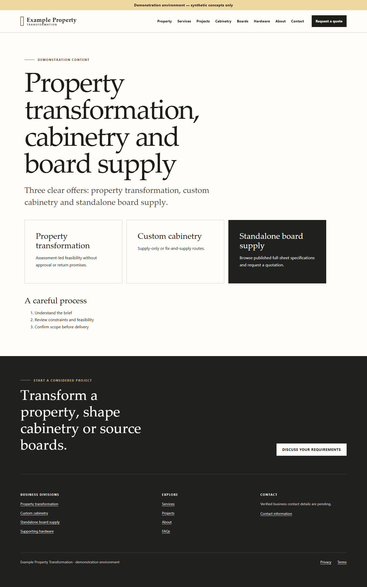
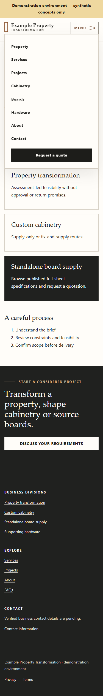

# UI-02 report — Premium header, navigation and footer

Date: 2026-10-22  
Status: **PASS**

## Outcome

Modernized the public Angular SSR application shell using the UI-01 design system. The new global
layout provides a compact architectural brand lockup, sticky desktop navigation, a responsive native
disclosure menu and a structured dark footer with business divisions, useful links and a clear
enquiry call to action. Existing public routes and backend contracts remain unchanged.

## Implementation

- Added a sticky, translucent header with the existing synthetic brand wording and a CSS-rendered
  brand mark. No external logo or icon asset was introduced.
- Added dedicated desktop navigation so links are visible without JavaScript or an opened
  disclosure. Active, hover and focus-visible states use UI-01 tokens.
- Retained the native `
` mobile menu and added a visual menu/close indicator. Escape closes
  the menu and returns focus to its summary; selecting a link closes it as well.
- Made desktop navigation wrap safely under 200% zoom instead of causing page overflow.
- Added a footer enquiry statement, functional quote CTA, business-division navigation, useful
  links, contact state, and legal links.
- The shell requests the allowlisted `/api/v1/public/config` endpoint using the existing SSR API
  origin. Verified configured email/phone values render as links. Reserved `example.invalid` email
  and blank phone values are suppressed and replaced by a truthful pending state.
- Configuration failure does not prevent the navigation, page content or enquiry CTA from rendering.
  No backend or public contract changes were necessary.

## Files changed

- `apps/public-web/src/app/app.ts`
- `apps/public-web/src/app/app.html`
- `apps/public-web/src/app/app.spec.ts`
- `apps/public-web/src/styles.scss`
- `tests/e2e/phase-03-public.spec.ts`
- `tools/capture-ui-02.mjs`
- `docs/development/screenshots/ui-02-desktop-home.png`
- `docs/development/screenshots/ui-02-mobile-menu.png`
- `docs/development/UI-02-REPORT.md`

## Screenshots

The screenshot helper uses the installed stable Chrome channel and targets the local built SSR
renderer. It does not contact an external service.

## Verification

| Check                               | Status | Actual result                                                                                                                                                          |
| ----------------------------------- | ------ | ---------------------------------------------------------------------------------------------------------------------------------------------------------------------- |
| `pnpm test -- --project public-web` | PASS   | 1 file, 3 tests passed, including placeholder suppression and verified configured contact rendering.                                                                   |
| `pnpm build:public`                 | PASS   | Browser and server bundles built; 9 routes prerendered. Initial estimated transfer 113.24 kB.                                                                          |
| `pnpm test:e2e:phase03`             | PASS   | 11 Chrome tests passed: 320/375/768/1024/1440 widths, every supported route at 320 px, 200% zoom, keyboard menu/FAQ/gallery behavior, SSR 404 and WCAG A/AA axe scans. |
| `pnpm format:check`                 | PASS   | All Prettier-managed files passed.                                                                                                                                     |
| `git diff --check`                  | PASS   | No whitespace errors.                                                                                                                                                  |

The host remains Node 23.5.0 and emits the existing odd-numbered/non-LTS warning; the project pins
Node 24.19.0. The warning did not fail a build or test.

## Remaining considerations

- Real business contact details remain unconfirmed in configuration. The footer intentionally
  displays a pending state rather than inventing an email, phone number, address or opening hours.
- The configured public schema currently contains email and phone only. A future approved location
  or opening-hours field requires a versioned configuration/contract change before it can appear.
- Human assistive-technology review remains appropriate when real branding and business details are
  approved; automated accessibility and keyboard checks pass.

## Git state

No commit or push was performed. Pre-existing prompt-document changes and the UI-01 work were
preserved.

Suggested commit: `feat(public): redesign responsive navigation and footer`
