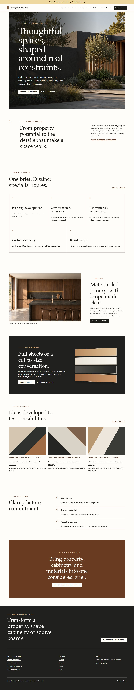
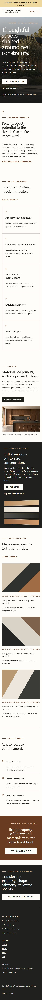

# UI-03 report — Takura Properties premium homepage redesign

Date: 2026-10-22  
Status: **PASS**

## Outcome

Redesigned the public homepage into a premium, responsive architectural experience using the UI-01
tokens and UI-02 shell. The composition uses original synthetic imagery, editorial typography,
spacious grids, material-led surfaces and restrained motion. Existing public APIs, routes, SSR,
noindex controls, enquiry flows and synthetic-content safeguards remain intact.

## Homepage structure

1. Architectural hero with original synthetic exterior imagery, explicit concept labelling and two
   functional calls to action.
2. An introduction explaining the connected, constraint-aware approach without claiming credentials
   or delivery outcomes.
3. Five service routes covering property development, construction/extensions,
   renovation/maintenance, cabinetry and board supply.
4. A cabinetry feature with original synthetic interior imagery and a preselected quotation CTA.
5. A dark board/workshop feature linking to the published catalogue and board-cutting qualification.
6. Up to three project cards populated from the existing published `/api/v1/projects` response.
7. A factual three-step process that distinguishes enquiry, clarification and agreed next steps.
8. A final quotation-discussion CTA using the existing enquiry route.

## Data and architecture

- Added `homeProjectsResolver`, which reuses `ContentApiService.list('projects')`. Published data is
  resolved during SSR and gracefully falls back to an empty public state when unavailable.
- No persistence, OpenAPI or backend changes were required.
- Existing project ordering, publication filters and public DTO boundaries remain owned by the
  backend. The homepage displays the first three returned published concepts.
- CTA query parameters use existing immutable service codes for cabinetry and board cutting.
- SEO title, description, canonical, structured metadata and environment noindex behavior continue
  through the existing `PublicPage` implementation.

## Imagery and rights

The image-generation skill caused two new original raster concepts to be created with the built-in
image generator and copied into the workspace:

- `apps/public-web/public/images/takura-home-hero-concept.png`
- `apps/public-web/public/images/takura-cabinetry-concept.png`

Prompts requested photorealistic editorial architecture in the charcoal/off-white/timber palette and
explicitly prohibited logos, text, watermarks, addresses, people and implications of completed client
work. The assets are labelled synthetic in the UI and documented in the adjacent image README. No
Theratio preview image or third-party stock asset was used. The cabinetry image is lazy-loaded;
intrinsic dimensions reserve its layout space. The hero is prioritized and both use descriptive alt
text.

## Accessibility and responsive behavior

- Semantic labelled sections and one page-level heading are preserved.
- All CTAs are real links to existing routes; no click-only containers were introduced.
- Layouts collapse to one column below 800 px. Full-bleed sections use bounded negative margins and
  passed the existing horizontal-overflow matrix.
- Motion is a short progressive entrance only and is removed under `prefers-reduced-motion`.
- Colour combinations passed the existing WCAG 2.0/2.1/2.2 A/AA axe checks.
- The page retains meaningful content and published project links in server-rendered HTML.

## Files changed

- `apps/public-web/src/app/app.routes.ts`
- `apps/public-web/src/app/content-api.service.ts`
- `apps/public-web/src/app/public.page.ts`
- `apps/public-web/src/styles.scss`
- `apps/public-web/public/images/README.md`
- `apps/public-web/public/images/takura-home-hero-concept.png`
- `apps/public-web/public/images/takura-cabinetry-concept.png`
- `tests/e2e/phase-03-public.spec.ts`
- `tools/capture-ui-03.mjs`
- `docs/development/screenshots/ui-03-desktop-home.jpg`
- `docs/development/screenshots/ui-03-mobile-home.jpg`
- `docs/development/UI-03-REPORT.md`

## Screenshots

## Verification

| Check                               | Status | Actual result                                                                                                                                             |
| ----------------------------------- | ------ | --------------------------------------------------------------------------------------------------------------------------------------------------------- |
| `pnpm build:public`                 | PASS   | Browser/server bundles built and 9 static routes prerendered. Initial estimated transfer is 116.05 kB excluding route images.                             |
| `pnpm test -- --project public-web` | PASS   | 1 file and 3 tests passed.                                                                                                                                |
| `pnpm test:e2e:phase03`             | PASS   | 12 Chrome tests passed, including SSR homepage imagery/CTA/project integration, 320–1440 px reflow, 200% zoom, keyboard flows, dynamic 404 and axe scans. |
| `pnpm format:check`                 | PASS   | All Prettier-managed files passed.                                                                                                                        |
| `git diff --check`                  | PASS   | No whitespace errors.                                                                                                                                     |

The local host uses Node 23.5.0 and emits the existing odd-numbered/non-LTS warning. The repository
remains pinned to Node 24.19.0.

## Limitations and follow-up

- Homepage project cards use abstract repository-owned CSS art because Phase 06 publication clearance
  has no approved project derivatives available for these synthetic records. Approved media can
  replace the art without changing the data resolver.
- Generated PNG source assets total approximately 5.3 MiB. Production media processing should emit
  responsive WebP/AVIF derivatives through the existing controlled media pipeline rather than
  introducing an unsigned shortcut in this UI task.
- No testimonial, statistic, accreditation, trading history, capacity, return, approval or completed
  customer project claim was introduced.

## Git state

No commit or push was performed. Existing uncommitted prompt and earlier UI task work was preserved.

Suggested commit: `feat(public): redesign homepage with premium architectural layout`
